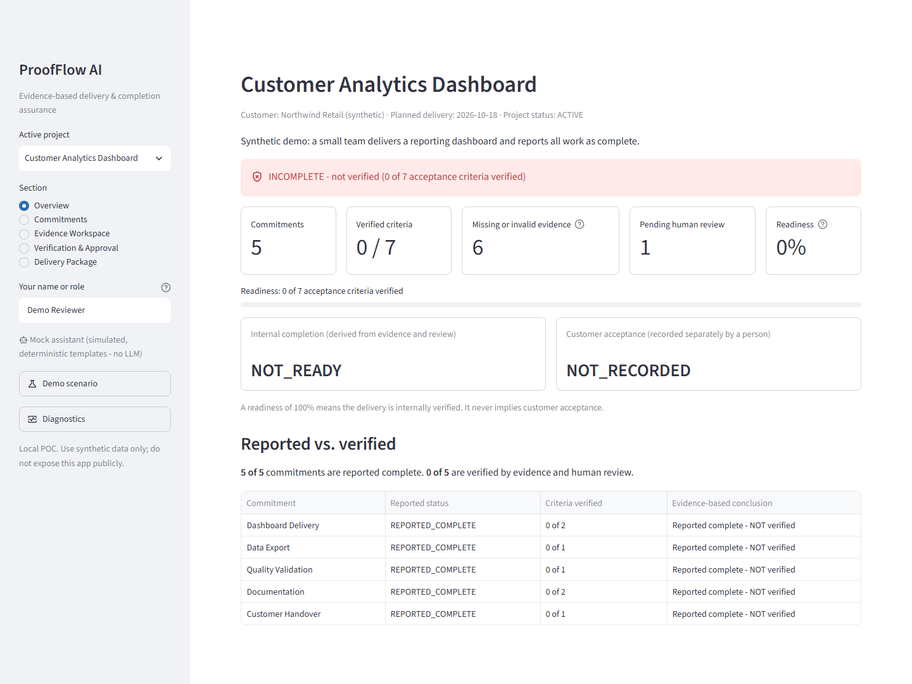
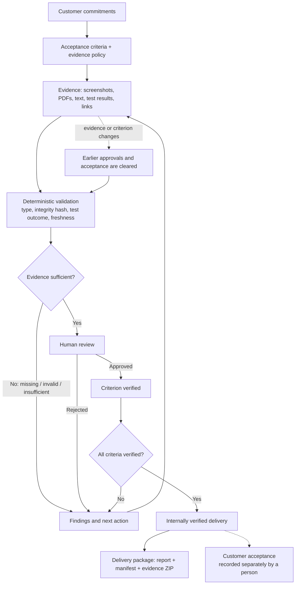
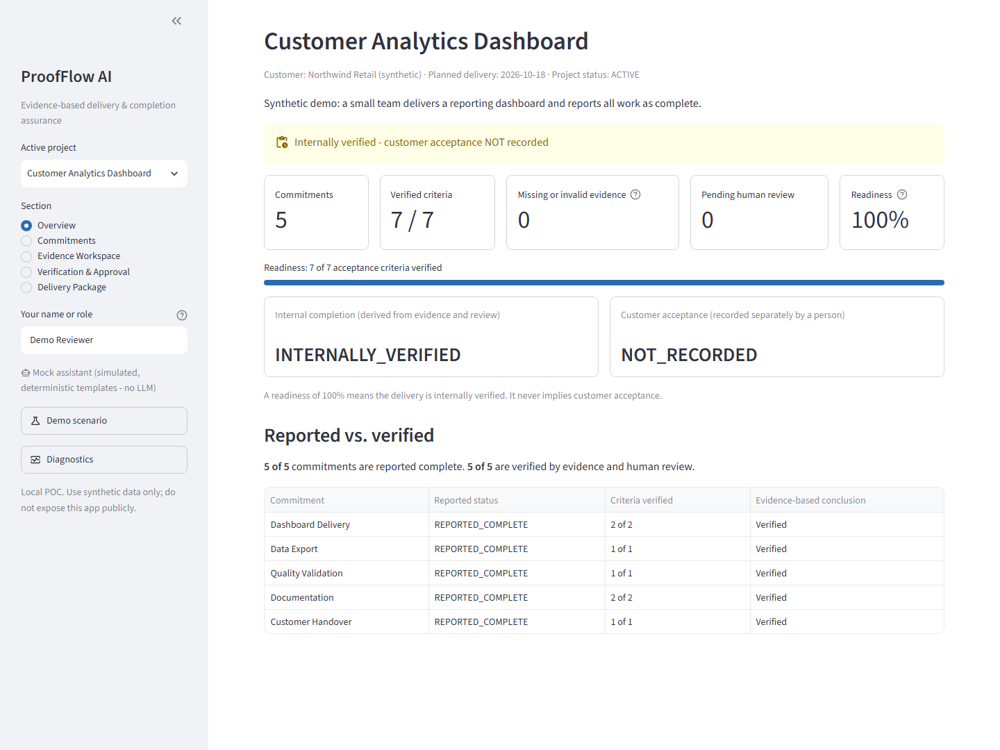
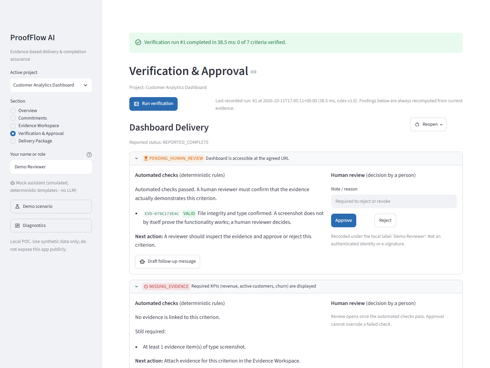

# ProofFlow AI

*Evidence-Based Delivery & Completion Assurance*

> **POC / MVP.** A local, single-user demonstration built with synthetic data. It is not a production system, has no authentication, and holds no compliance certification. See [Limitations](docs/limitations.md).



## What

ProofFlow AI turns a list of customer commitments, their acceptance criteria and the supporting artifacts into a verification report and a downloadable delivery package. It checks each piece of evidence with deterministic rules, asks a person to confirm what a machine cannot judge, and shows exactly what is still missing before a delivery can honestly be called done.

## Why

"Done" in a task tracker only means someone said so. Teams regularly hand over work where a screenshot does not show the claimed result, a test run actually failed, a document is still a draft, or nobody recorded the customer's sign-off. The gaps surface later as follow-up messages and disputed deliveries.

ProofFlow keeps five things apart that are usually blurred together:

1. Work **reported** as complete
2. Evidence **submitted**
3. Evidence **validated** against explicit rules
4. Completion **approved** by a human reviewer
5. **Customer acceptance**, recorded separately

A completed task is not automatically a verified deliverable, and a verified deliverable is not automatically an accepted one.

## How



Every acceptance criterion carries a small evidence policy: which evidence types count, how many valid items are needed, whether a passing test result is required, how old evidence may be, and whether a person must review it. The rules engine assigns each criterion exactly one status:

| Status | Meaning |
|---|---|
| `MISSING_EVIDENCE` | Nothing is attached |
| `INVALID_EVIDENCE` | An attached item fails validation (wrong type, corrupted, changed since upload, malformed) |
| `INSUFFICIENT_EVIDENCE` | Valid items exist but do not satisfy the policy (e.g. the latest test run failed, or only an unverified link) |
| `PENDING_HUMAN_REVIEW` | Automated checks pass; a reviewer must decide |
| `REJECTED` | A reviewer rejected the evidence, with a reason |
| `VERIFIED` | Automated checks pass and a reviewer approved |

Readiness is simply `verified criteria / total criteria × 100`. Details: [verification model](docs/verification-model.md).

### Main features

- Projects, commitments and separately verifiable acceptance criteria
- Evidence upload (PNG/JPEG, PDF, TXT/Markdown, JSON test results) and link references, each tied to one criterion
- SHA-256 integrity tracking; changed, corrupted or missing files are detected
- Explainable findings with the specific gap and the next action for each criterion
- Human approve / reject / revoke / reopen with an append-only local history
- Approvals and customer acceptance are cleared automatically when the evidence or criterion changes
- Delivery package: HTML report, JSON manifest with hashes, and the evidence files in one ZIP — clearly labelled `INCOMPLETE` when it is
- Optional drafting help for follow-up messages and handover wording (see [AI](#ai-optional-and-advisory))

## Quick start

Requires Docker.

```bash
docker compose up --build -d
```

Open <http://localhost:8501>. The synthetic demo project is loaded on first start.

```bash
docker compose down        # stop; your data is kept in the proofflow-data volume
docker compose down -v     # stop AND permanently delete all local projects and evidence
```

<details>
<summary>Run without Docker</summary>

```bash
python -m venv .venv
.venv/Scripts/activate            # Windows;  source .venv/bin/activate on macOS/Linux
pip install -r requirements.txt
streamlit run app/main.py
```

Data is stored in `./data` (override with `PROOFFLOW_DATA_DIR`).
</details>

## Example workflow

1. **Overview** — see what is reported versus what is actually verified.
2. **Commitments** — define commitments and their acceptance criteria.
3. **Evidence Workspace** — attach evidence to a criterion and see how it validates.
4. **Verification & Approval** — run verification, read the findings, approve or reject as a reviewer.
5. **Delivery Package** — record customer acceptance (separately) and download the package.

## Before / After demonstration

The bundled scenario is a fictional *Customer Analytics Dashboard* delivery: five commitments, seven acceptance criteria, all reported complete. These numbers are produced by the application, not estimated:

| | Before | After evidence is supplied | After human review |
|---|---|---|---|
| Commitments reported complete | 5 of 5 | 5 of 5 | 5 of 5 |
| Commitments verified | **0 of 5** | 0 of 5 | **5 of 5** |
| Criteria verified (readiness) | 0 of 7 (0%) | 0 of 7 (0%) | 7 of 7 (100%) |
| Gaps detected automatically | 6 (2 missing, 1 invalid, 3 insufficient) | 0 | 0 |
| Awaiting a human decision | 1 | 7 | 0 |
| Delivery package | labelled `INCOMPLETE`, 7 outstanding items | labelled `INCOMPLETE` | complete; acceptance still `NOT_RECORDED` |

The six gaps found in the *Before* state: a missing KPI screenshot, missing release notes, a "tests passed" note with no test record behind it, a test run reporting 3 failures out of 42, a draft Markdown guide where a PDF was required, and a handover "proof" that is only a link. The one screenshot that exists is held for human review rather than counted as proof.

On the development machine, assessing the demo project took about 13 ms and building the package about 45 ms. Time saved for a real team is **not** measured here and no such claim is made.

| After human review | Findings in the Before state |
|---|---|
|  |  |

Step-by-step walkthrough: [demo guide](docs/demo-guide.md).

## AI (optional and advisory)

The verification engine uses no AI. It is deterministic and behaves identically in every mode.

- **Mock (default)** — template-based drafting of follow-up messages and handover summaries. Runs offline, needs no key, and is labelled in the UI as simulated assistance, not an LLM.
- **LLM (opt-in)** — the same two drafting functions through the Anthropic API. Output is schema-validated, may only cite IDs present in the input, and falls back to Mock on any error or timeout. It cannot approve, verify, or change any status. This path is covered by tests with a stubbed client; it has **not** been exercised against the live API.

## Testing

```bash
pip install -r requirements-dev.txt && playwright install chromium
pytest
```

| Suite | Tests | Covers |
|---|---|---|
| Unit | 124 | Rules and status precedence, readiness, freshness, hashing, upload/filename/link validation, AI contract and fallback, report escaping |
| Integration | 66 | SQLite persistence, evidence registration, review transitions, approval invalidation, acceptance, export and manifest consistency, the Before/After scenario |
| Browser E2E | 2 | The full workflow through the real UI in Chromium, including upload and validation of the downloaded ZIP |

All 192 pass locally; the E2E suite also passes against the Docker container. More in [assurance](docs/assurance.md).

## Main limitations

- Local demonstration only: no authentication, and reviewer names are typed labels, not verified identities.
- Hashes prove a file has not changed since upload — not that its content is true.
- Links are never fetched; they are unverified references.
- Approvals are not electronic signatures and the history is not a tamper-proof audit ledger.
- Customer acceptance is whatever a person records; the tool cannot confirm it with the customer.

Full list: [limitations](docs/limitations.md).

## Documentation

- [Architecture](docs/architecture.md)
- [Verification model](docs/verification-model.md)
- [Assurance: QA, security, observability, AI guardrails](docs/assurance.md)
- [Demo guide](docs/demo-guide.md)
- [Limitations](docs/limitations.md)
