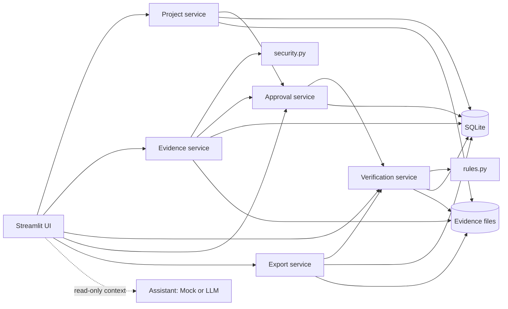

# Architecture

ProofFlow AI is one Python process: a Streamlit UI over a small set of services, a pure rules module, SQLite and a local evidence folder. There are no other services.

## Components

```text
app/
├── main.py              Streamlit entry point: sidebar, project selection, routing
├── ui/                  One module per section; presentation only
├── services/
│   ├── project_service        projects, commitments, criteria and their evidence policies
│   ├── evidence_service       validates and stores uploads, records links
│   ├── verification_service   runs the rules over recorded inputs; records runs and metrics
│   ├── approval_service       approve / reject / revoke / reopen, customer acceptance, history
│   └── export_service         manifest, HTML report, ZIP
├── rules.py             Deterministic verification rules (pure functions)
├── security.py          Upload, filename, text and URL validation
├── storage.py           SQLite repository + confined evidence file store
├── models.py            Domain dataclasses and enums
├── ai/                  Optional advisory assistant (Mock and LLM adapters)
├── demo_data.py         Synthetic Before/After scenario
├── observability.py     Structured JSON logging
├── healthcheck.py       Readiness probe used by Docker
└── config.py            Environment-based settings
```

## Data flow



1. An upload is validated (`security.py`), hashed, stored under a generated name and recorded against one criterion.
2. Any evidence or criterion change calls the approval service, which clears review decisions and customer acceptance that no longer apply.
3. The verification service reads the criterion, its evidence records and the stored bytes, and hands them to `rules.py`, which returns a finding per criterion and a project assessment.
4. The approval service consults the current finding before allowing a decision, so a person can never approve something the rules have blocked.
5. The export service runs a fresh verification and renders the manifest, report and ZIP from that single result.

## Core choices

**Rules are pure functions.** `rules.py` has no database, file or network access. It receives records, bytes and a timestamp and returns a result, which makes outcomes reproducible and easy to test.

**Statuses are computed, not stored.** A criterion's status is derived from current inputs every time it is shown. Only inputs (evidence, policy, human decisions) are persisted, so the UI cannot display a stale `VERIFIED`. "Run verification" additionally records a timestamped run with its metrics and saves per-evidence validation results.

**Human decisions are bound to what was reviewed.** Each decision stores a fingerprint of the criterion text, its policy and the evidence set. If that fingerprint no longer matches, the decision is ignored. This is a second line of defence behind the explicit invalidation in step 2.

**The assistant is outside the trust boundary.** `app/ai` receives a bounded dictionary and returns text. It holds no reference to the repository or services, and no module in `services/`, `rules.py`, `storage.py` or `security.py` imports it (a test enforces this).

**Dependencies are wired once.** `services/__init__.py` builds the object graph from `Settings`; tests build the same graph against a temporary directory.

## Persistence

SQLite, one file (`proofflow.db`), six tables: `projects`, `commitments`, `criteria`, `evidence`, `audit_log`, `verification_runs`. Foreign keys cascade on delete. `audit_log` is protected by triggers: rows cannot be updated, and cannot be deleted while their project exists.

Evidence files live in `evidence/<project id>/<evidence id><extension>` beside the database. Names are generated by the application; the original filename is kept only as sanitized metadata. In Docker both live in the `proofflow-data` volume mounted at `/data`.

**Retention and deletion.** Data stays until the user removes it. Removing an evidence item deletes its file and leaves a history entry. Deleting a project deletes its rows, files and history. `docker compose down -v` deletes everything.

## Why this is lightweight

The workload is one user, a handful of projects and files of at most a few megabytes. Assessing the demo project takes about 13 ms. A separate API, queue, cache, external database or orchestration layer would add operational surface without solving a problem this POC has. The service boundaries are the seams where that could change later: the repository could move to another database, and the services could sit behind an API, without touching the rules.

The only runtime dependency is Streamlit. The `anthropic` client is optional and installed only on request.
